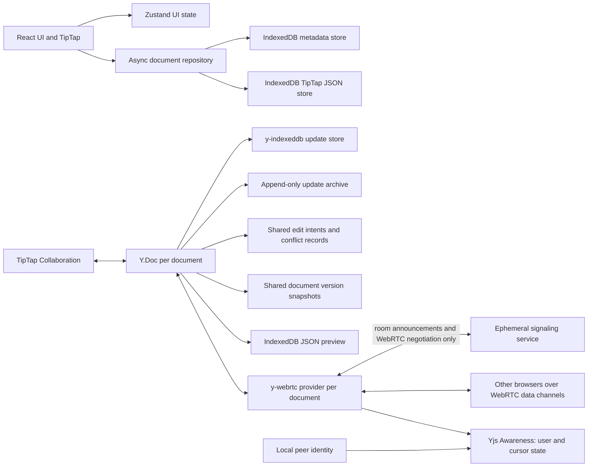

# Architecture

## Intended component boundaries

The client owns its local documents. Each opened document gets one Y.Doc session, restored by y-indexeddb before TipTap mounts. TipTap Collaboration binds the editor to the document's `default` Y.XmlFragment, and collaborative undo replaces StarterKit's local undo plugin. A one-time seed imports existing TipTap JSON only when the Yjs fragment has no initialization marker and no content. Yjs updates are persisted locally; a debounced JSON projection is written to the IndexedDB content store for dashboard previews and legacy repository flows. On open, the projection is refreshed from Yjs if it is stale. Each open editor binds a y-webrtc provider to this same Y.Doc; the stable document ID names the room. Once established, data channels carry Yjs sync and Awareness messages directly between browsers. Signaling is ephemeral rendezvous for room discovery and WebRTC negotiation only.

The current implementation contains the React shell, dashboard, TipTap editor, local document CRUD, IndexedDB autosave, TipTap/Yjs binding, local CRDT update persistence, y-webrtc peer transport, Awareness presence, a signaling-only service, offline reconnect state-vector checks, and shared conflict review records. The one-time Phase 2 migration imports localStorage documents into separate metadata and content stores without deleting the source key. Migration is transactional, verified after commit, marked complete only after verification, and safe to retry. Yjs sessions and peer providers are document-scoped, deduplicated per app runtime, and released on editor teardown; development StrictMode remounts are tolerated.

## Data ownership

- Document metadata: IndexedDB `documents` object store.
- Current editor content: per-document Y.Doc `default` XML fragment, persisted as Yjs updates in y-indexeddb.
- Content projection: IndexedDB `content` object store, reconciled from Yjs on open and after debounced local updates.
- Legacy localStorage JSON: migration input only; retained after migration and never treated as current canonical state.
- Local profile: not implemented. Document metadata is stored in IndexedDB.
- Presence, cursors, and advertised sync vectors: Yjs Awareness state, sent by y-webrtc over WebRTC. Presence/cursors are ephemeral; a peer restores identity and its current state vector after y-webrtc disconnect clears local Awareness.
- Conflict review: shared edit-intent array, stable block identity aliases, and canonical conflict-record map inside the Y.Doc. y-indexeddb persists them and y-webrtc replicates them with the rest of the document. A manual resolution writes the selected rich ProseMirror block into the editor and stores its rich JSON plus resolved status in the shared map.
- Document version history: a separate Y.Map of named full TipTap JSON snapshots inside the same Y.Doc. y-indexeddb persists it and y-webrtc replicates it; it is independent of conflict records and the raw-update archive.
- Signaling: transient in-memory room membership and validated WebRTC negotiation frames; no document state or durable storage.

Yjs deterministically merges CRDT operations and safely applies repeated/out-of-order updates. Phase 6 records complete before/after snapshots for each locally changed text block, with author, timestamp, causal vectors and a local changed range. The detector groups intents by stable Yjs block identity and connected causal concurrency across participants. A canonical conflict ID combines document ID, block ID and the first intent from each participant's episode, so character edits and replayed updates do not create new records. Separate block IDs remain separate conflicts. Resolved canonical records prevent replay from reopening an episode. Existing pairwise v1 records remain stored; startup derives one canonical v2 record from their intent groups and carries forward resolved metadata.

Conflict candidates retain full ProseMirror JSON for the affected text block, including block type, attrs, inline marks, links and nested supported content. Review replaces only that block at its current Yjs-backed identity; surrounding paragraphs, headings, list/table containers and formatting remain in place. Custom resolutions splice text into a preserved rich block and inherit marks around the changed range. This groups by logical block, not raw operation count. Conflict classification is not a complete semantic merge engine.

On reconnect, the app restores its local Awareness identity and advertises the Yjs state vector. The UI only reports `Synced` when y-webrtc reports room sync, at least one WebRTC peer is connected, and the advertised vectors for every connected peer match the local vector. A browser with no connected peer reports a local-only state; matching vectors are not a guarantee against a peer disconnecting immediately afterward.

The PWA/service worker is not implemented in Phase 6. A document remains recoverable from IndexedDB if the application is loaded again, but the app shell itself is not guaranteed to reopen after a browser restart without network access. IndexedDB eviction/quota limits and multi-week offline behavior remain platform risks and have not been endurance-tested.

## Identity and trust

The initial product will use a persistent local identity, not server authentication. A shared room identifier is not strong authorization by itself. Share links need sufficient entropy and explicit revocation/rotation controls. WebRTC encrypts transport, but that alone does not establish trusted peer identity or prove application-level end-to-end identity. TSG must not advertise stronger guarantees until identity verification and threat-model tests exist.

## Connectivity

Direct WebRTC connections may fail across restrictive NATs or firewalls. The current browser config uses a public STUN endpoint by default; STUN helps discover viable paths, while some networks require TURN relaying. TURN relays encrypted transport packets but must not become document storage or an application synchronization database. Cross-network connectivity is not guaranteed or tested as a universal property. See [P2P networking](./P2P_NETWORKING.md) for LAN setup, firewall, trust, and deployment details.

## Version history

The version-history manager writes snapshots only to the existing document Y.Doc. Each snapshot stores the complete TipTap JSON tree, including formatting, links, node attributes and nested structures. The first local edit adds a shared starting baseline; remote edits do not generate local checkpoints. Automatic versions use a configurable policy with a 30-second quiet window, a five-minute minimum interval, and a substantial-change threshold (80 changed text characters, two changed blocks, or a formatting/structure change). Manual named versions are immediate. Exact and near-identical content is deduplicated; explicit restores always create a new restore entry.

Restore validates the snapshot against the current editor schema and dispatches a replacement transaction through the already-mounted TipTap Collaboration extension. The Y.Doc, y-indexeddb provider, WebRTC provider, and Awareness object remain intact. The restored version record is a Yjs map update, so connected peers receive it through the same P2P path and offline peers receive it during later Yjs synchronization. The panel only labels history synced when the existing network status reports matching Yjs state vectors with connected peers; otherwise it reports that the version history is local or synchronizing.

Deleting a saved version deletes only its key from the shared version Y.Map, then flushes the existing Yjs persistence session before reporting success. The panel asks for confirmation, disables deletion for a snapshot identical to the current live document, and surfaces storage errors. The Y.Map deletion propagates through Yjs to connected and later-reconnecting peers. This is a logical deletion from the current shared version map and local restored state. Yjs records deletions as CRDT tombstones, and the separate append-only raw-update archive may still contain the earlier update bytes; those bytes are not purged because doing so could break offline peers or erase unrelated document updates. This feature does not provide secure physical erasure from historical Yjs update archives.
