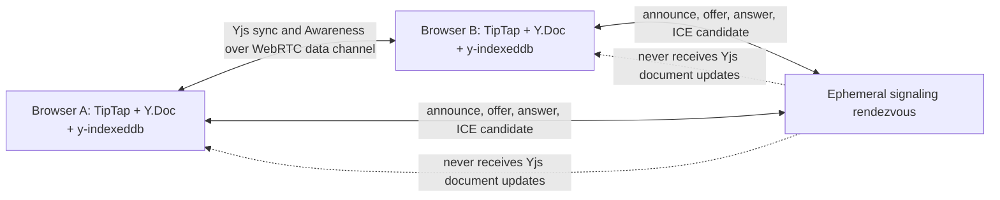

# P2P networking

## Current Phase 5 implementation

Each open document acquires one `WebrtcProvider` from `PeerProviderStore`, bound to the already-opened Y.Doc from `documentYjsStore`. The room name is the stable document ID. TipTap remains bound to that same Y.Doc. `filterBcConns` is enabled so peer status represents WebRTC data-channel connections rather than same-browser BroadcastChannel connections.



The TypeScript service in `signaling/server.ts` handles the y-webrtc WebSocket protocol. It validates and briefly relays only room subscription and WebRTC negotiation messages. It keeps an in-memory set of current sockets per room and does not write room data, document content, or Yjs updates to storage. The document's Yjs synchronization messages and Awareness updates are sent by y-webrtc over established WebRTC data channels. HTTP `/health` returns connection and room counts only.

`PeerNetworkSession` reports browser online/offline, signaling socket, discovered peers, actual open WebRTC connections, y-webrtc sync state, and remote Awareness users. Phase 6 also advertises Yjs state vectors through Awareness; `Synced` requires room sync and matching vectors with every currently connected WebRTC peer. y-webrtc clears its local Awareness state when disconnected, so the app restores its local guest identity and current vector when it reconnects. The editor renders collaborators from Awareness and uses TipTap CollaborationCaret for remote cursors and selections. No synthetic user presence is generated. The persistent, locally created guest identity is not authenticated by the signaling service.

The app creates one provider per Y.Doc per tab/runtime and shares it among React mounts. Editor teardown releases the provider; closing/deleting a document destroys active peer connections and clears local Yjs persistence. A transient zero-delay release allows React StrictMode's development remount cycle to reuse a session safely.

## Running two laptops on one Wi-Fi network

1. On the host laptop, install dependencies and start the signaling service in one terminal:

   ```sh
   npm install
   npm run signaling
   ```

2. In another terminal on the host, start Vite:

   ```sh
   npm run dev
   ```

   Vite listens on all interfaces. By default the editor derives its signaling address from the hostname used in the browser, port `4444`.

3. Find the host's Wi-Fi IPv4 address. On Windows, run `ipconfig` and use the IPv4 Address under the active Wireless LAN adapter. On macOS, use `ipconfig getifaddr en0`; on Linux, use `ip -4 addr` and select the active Wi-Fi interface.

4. If the second laptop cannot use the same hostname, create `.env.local` in the project before starting Vite and set:

   ```dotenv
   VITE_SIGNALING_URL=ws://192.168.1.20:4444
   ```

   Replace the example with the host's Wi-Fi IPv4 address, then restart Vite. The value is public transport configuration, not a secret. Do not put TURN credentials or private keys in any `VITE_*` variable.

5. In browsers that allow development HTTP on the LAN, open `http://192.168.1.20:5173` on both laptops. The host creates a document and uses Share to copy its link. The second laptop opens the link and explicitly selects **Join document**. Both devices must use the same signaling address and document link.

6. Permit inbound TCP ports 5173 (Vite) and 4444 (signaling) on the host firewall, and allow outbound WebRTC UDP traffic on both laptops. Some Wi-Fi access points enable client isolation; in that case the laptops cannot establish a direct local peer connection even though the site loads. Browser permission prompts or VPN/firewall policies can also affect connectivity.

To verify disconnect/reconnect, wait for **Connected · 1 peer**, close the second editor tab, and confirm the first returns to **Waiting for collaborators**. Reopen the share link and join again; the document's local Yjs state is restored and exchanged after the data channel reconnects. A disconnected peer continues to edit its own local copy. Phase 6 Playwright coverage verifies a short offline interval, tab reopen after connectivity returns, and three-peer reconnect order C/A/B; the tests are not multi-week endurance tests or physical browser-process crash/restart simulations.

### Browser secure-context note

The automated tests use `http://127.0.0.1`, which browsers treat as a trustworthy loopback origin. A LAN IP over plain HTTP is not equivalent: modern browsers can require a secure context and may gate access to local-network services. For current Chromium, serve the frontend over HTTPS and the signaling endpoint over WSS using a trusted certificate on both laptops. A local reverse proxy can terminate TLS and forward HTTPS to Vite at port 5173 and WSS to the signaling process at port 4444; configure `VITE_SIGNALING_URL=wss://<host-ip>:<tls-port>` and set `WS_ALLOWED_ORIGINS` to the exact HTTPS frontend origin. Install/trust the local certificate authority on the second laptop. The plain HTTP instructions are useful for browsers and network setups that permit them, but real two-laptop LAN connectivity has not been tested in this checkout. Browser local-network rules evolve; Chrome's [Local Network Access guidance](https://developer.chrome.com/docs/modern-web-guidance/guides/security/local-network-access) requires secure contexts for local-network requests.

## STUN and TURN

The default ICE configuration uses a public Google STUN endpoint. STUN helps peers discover candidate network addresses; it does not relay document data. Set `VITE_STUN_URLS` to a comma-separated list to use other public or self-hosted STUN URLs.

Some NATs and restrictive networks cannot establish a direct path with STUN alone. A TURN server relays WebRTC transport packets and may be needed for those peers. This project does not currently configure TURN credentials or demonstrate cross-network TURN connectivity. TURN is a transport relay, not TSG document storage or a centralized Yjs synchronization service. Cross-network reachability is not guaranteed until the deployment's ICE/TURN setup is configured and tested.

## Signaling operations and trust

Run `npm run signaling` for local development. Build and run the standalone service with `npm run signaling:build` and `npm run signaling:start`; it listens on `0.0.0.0:4444` or the `PORT` value. Set `WS_ALLOWED_ORIGINS` in the service process to a comma-separated allowlist in deployment. Keep signaling behind TLS (`wss:`) in public deployments and add appropriate rate limiting/monitoring at the edge. Do not expose secrets in frontend build variables.

A room/document ID currently acts as a bearer invite. The service does not authenticate identities or enforce document permissions, and a peer that knows the ID may join. Awareness names are user-controlled metadata. WebRTC encrypts transport, but this application has not implemented peer identity verification or application-level end-to-end encryption. Share only with trusted people.

## Verification status

Signaling protocol tests verify that discovery frames are relayed, document-update payloads are rejected, and the service reports no stored document data. Playwright tests use independent Chromium browser contexts against the real local Vite app and signaling service, verify peer presence, Yjs content exchange and replica convergence, and exercise leave/rejoin and multi-peer rooms. These tests run on loopback; actual two-laptop Wi-Fi, arbitrary NATs, and public internet connectivity have not been tested. Run `npm test`, `npm run test:e2e`, `npm run signaling:build`, `npm run build`, and `npm run typecheck:integration` for the current verification commands. See `PROGRESS.md` for the actual results recorded for this checkout.

## Not implemented here

PWA/app-shell offline reopening, multi-week endurance/fault-injection, cross-network TURN, authenticated sharing, stronger semantic conflict classification, comments/activity, and version-history UI remain future milestones. Current block-level grouping, rich-text snapshots and their semantic limits are described in [CRDT_EXPLANATION.md](./CRDT_EXPLANATION.md).
